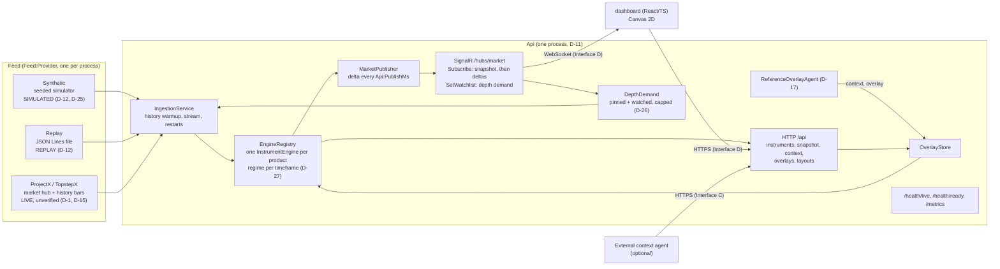
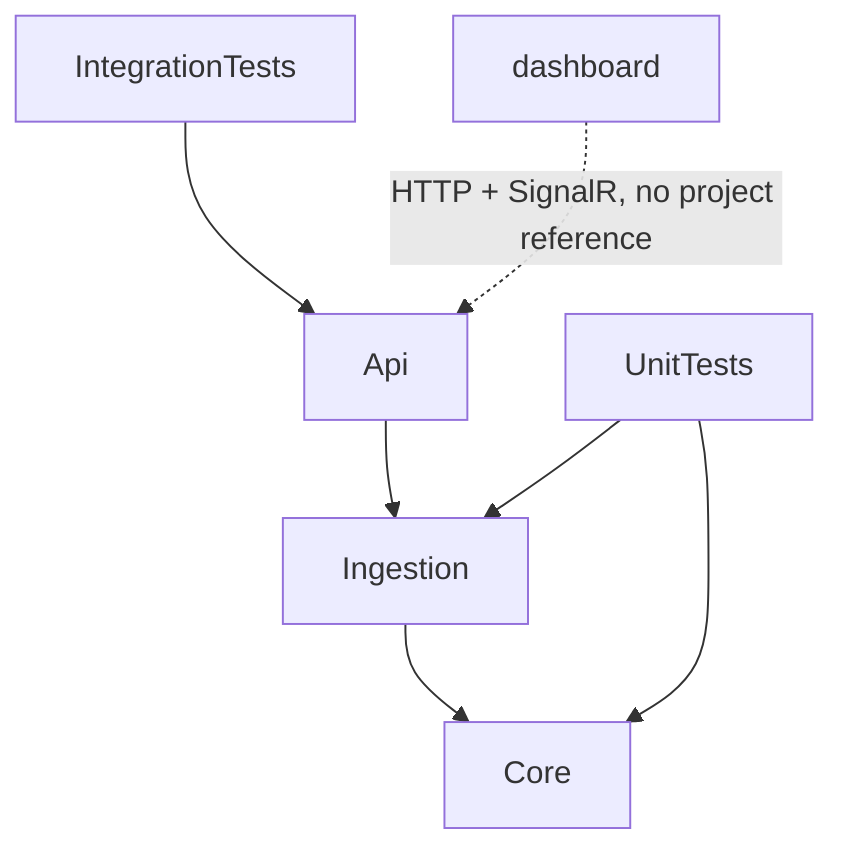

# Architecture

How the Live Futures Liquidity Dashboard is put together: the projects, how they depend on one another, the
components and the data flow, every design decision (`D-n`), the threat model (`T-n`) and the performance
baselines. The requirements the decisions serve are in [`REQUIREMENTS.md`](REQUIREMENTS.md); the wire contracts
are in [`INTERFACES.md`](INTERFACES.md).

## What it is

A read-only live view of resting liquidity beside executed price for every product the feed offers, one in detail
at a time, with MES, MCL and MGC as the default favorites and an Overview of all of them (D-26, D-28). One ASP.NET
Core process holds the one market-data session for every instrument, keeps a bounded in-memory state per
instrument, computes the heatmap, bars, indicators, profiles, liquidity metrics and order-flow signals, and pushes a
snapshot followed by ordered deltas to the React/TypeScript client over SignalR. An advisory agent reads a
read-only context and publishes overlays of levels back. Nothing in any path can place, change or cancel an order
(FR-6).

The callers are the browser dashboard (`view-dashboard`, `configure-layout`) and a context agent (`read-context`,
`publish-overlay`); both present an API key outside Development (D-16, D-30). The market-data connection is
outbound only. `/health/live` is anonymous for the platform's check; `/health/ready` and `/metrics` require an
authenticated caller outside Development, because readiness names every instrument's status.

### Today

Built: the three feeds and the hosted ingestion; the per-instrument engine (order book, slice integrator, trade
bars, indicators, profiles, liquidity metrics, footprint and every order-flow detector of FR-36–FR-52) and the
trend regime (FR-56); every product the feed offers, with depth only where it is watched (FR-54); the product
picker, the Overview tab and the Order Flow tab (FR-55, FR-57, FR-67); the footprint as Detail's main chart and
the indicator dock shared by Detail and Order Flow (D-55, D-56); per-theme chart colours a viewer may choose
(FR-71); the snapshot and delta protocol; the REST
API with overlay intake and layouts; API-key authentication with per-instrument grants; the reference overlay
agent; health checks and the feed, ingest and publish metrics (D-32). The dashboard is an installable PWA; a
Capacitor Android shell builds as a debug APK (D-31). Unit tests cover Core and Ingestion; integration tests host
the API on the synthetic feed; the dashboard's components are tested with vitest and Testing Library.

**Not built yet:**

- **A measured rendering choice.** Everything is drawn on plain Canvas 2D with no chart library. Synthetic
  frame-time readings are below; the target hardware is not declared, so D-2 stays open.
- **Resume.** A gap in sequence makes the client take a new snapshot; there is no resume token or replay window
  (FR-4, NFR-3). A slow browser is not waited on (D-32).
- **Durable recovery data.** Market state is in memory; a restart rebuilds it from history warmup (D-18; D-6 is
  open). There is no checkpoint store and no profile backfill reconciliation (FR-25). A viewer's layout is the
  exception: the browser keeps a valid copy and restores it after a restart.
- **Calendar and roll.** Exchange holidays and early closes are not modelled, and there is no roll policy (D-5).
- **Further metrics and alerts** beyond those in [`OBSERVABILITY.md`](OBSERVABILITY.md) §2.

## Projects

| Project | Path | Type | Responsibility |
|---|---|---|---|
| Api | `src/MarqSpec.FuturesLiquidityDashboard.Api/` | ASP.NET Core Web API | The one deployable (D-11): hosts ingestion; the REST routes, SignalR hub and publisher (Interface D); overlay intake and the reference agent (Interface C); API-key auth (D-16); layouts (FR-9); health and metrics |
| Ingestion | `src/MarqSpec.FuturesLiquidityDashboard.Ingestion/` | Class library | The feeds (Synthetic, Replay, ProjectX; Interfaces A and B), normalization to `MarketEvent`s with epoch and sequence, history warmup, stream restarts, readiness state |
| Core | `src/MarqSpec.FuturesLiquidityDashboard.Core/` | Class library | Instruments and sessions; the per-instrument engine; the wire models; overlay validation. No I/O |
| UnitTests | `src/tests/MarqSpec.FuturesLiquidityDashboard.UnitTests/` | xUnit | Deterministic fixtures for Core and Ingestion ([`CONVENTIONS.md`](CONVENTIONS.md) §8) |
| IntegrationTests | `src/tests/MarqSpec.FuturesLiquidityDashboard.IntegrationTests/` | xUnit | The API in process (`WebApplicationFactory`) on the synthetic feed: REST, hub, auth, read-only guard, metrics |
| dashboard | `src/dashboard/` | React + TypeScript (Vite) | The browser client: API and SignalR client, schema validation, snapshot and delta merge, and the Canvas 2D views (Detail, Overview, Order Flow), styled on the design tokens in `src/dashboard/src/design/tokens.json` (D-42); `android/` is the Capacitor shell (D-31) |

## Dependencies between projects

Dependencies point inward: the host references the libraries, and a library never references the host or the web
framework, so the engine stays independent of the transport. Api reaches Core through Ingestion.

External packages: Ingestion uses the `MarqSpec.Client.ProjectX` NuGet package (D-15); Api uses OpenTelemetry with
the Prometheus exporter and `Microsoft.AspNetCore.OpenApi`. Versions are pinned in `Directory.Packages.props`.

## Major components

| Component | Where | Owns | Requirements |
|---|---|---|---|
| Feeds | Ingestion `Feeds/`, `Synthetic/`, `Replay/`, `ProjectX/` | One `IMarketDataFeed` per process, chosen by `Feed:Provider`: history warmup and a live stream of normalized events with epoch, sequence and provenance. `InstrumentSelection` (which products) and `DepthDemand` (which get depth) | FR-11, FR-53, FR-54, NFR-5; D-12, D-15, D-25, D-26 |
| Ingestion host | Ingestion `Hosting/` | `IngestionService`: binds contracts, loads the history window, streams, restarts with 1–30 s backoff, but stops without retrying on a refused login or a bad feed setting (D-37). `MarketIngestBuffer` bounds the live queue (D-32) | FR-4, FR-5, NFR-3, NFR-4; D-11, D-32 |
| Order book | Core `Book/` | Side and price quantities on integer tick keys; covered depth; unknown until a snapshot; reset per epoch. A tick whose size is not known is marked unknown per side, never zero | FR-5, FR-11 |
| Slice integrator | Core `Heatmap/` | Time-weighted resting quantity per one-second slice and its coverage; heat columns | FR-1, FR-11, FR-12 |
| Trade bars | Core `Bars/` | De-duplicated trades, one-minute OHLCV bars with explicit empty bins | FR-13, FR-14 |
| Indicator engine | Core `Indicators/` | EMA 10/13/24/48/200, session VWAP, RSI 14, MACD 12/26/9, ATR 14 on 1-, 5- and 15-minute series; closed and developing values | FR-16–FR-22; D-9, D-13 |
| Profile engine | Core `Profile/` | Volume at price for the session, 1 h, 4 h and 5 days; POC and value area | FR-23–FR-25, FR-50 |
| Liquidity metrics | Core `Liquidity/` | Spread, microprice, depth and imbalance, added/pulled/filled, delta, trade rate, session volume, walls | FR-36–FR-40 |
| Order-flow analyzer | Core `OrderFlow/` | Footprint, imbalances and zones, unfinished auctions, delta spikes, trapped traders, CVD and divergence, exhaustion, pulled liquidity, sweeps, icebergs, HVN/LVN, TPO; each switchable under `Engine:OrderFlow` | FR-41–FR-52; D-19–D-24 |
| Regime | Core `Regime/` | ADX, efficiency ratio and EMA 13/48 on 5- and 15-minute bars | FR-56; D-27 |
| Session calendar and levels | Core `Sessions/`, `Levels/` | Globex sessions in US Central time with the daily break and DST; named session levels | FR-15, FR-63; D-5, D-35 |
| Instrument engine and registry | Core `Engine/` | One `InstrumentEngine` per instrument behind a lock; snapshots, deltas (only while watched), the picker summary, the agent context, status, retention | FR-4, FR-54, FR-55, NFR-1, NFR-4 |
| Publisher | Api `Hubs/` | `MarketHub`, `WatchTracker` (per-connection subscriptions, timeframe and watchlist) and `MarketPublisher`, which sends each watched engine's delta every `Api:PublishMs` (250 ms). A browser still taking the previous send gets no further delta and is aborted after `Api:PublishTimeoutMs` (D-32) | FR-4, FR-54, NFR-1, NFR-4 |
| REST endpoints | Api `Endpoints/`, `Layouts/` | Instruments, snapshot, context, overlays, layouts | FR-8, FR-9 |
| Overlay intake | Core `Overlays/` + Api `Endpoints/` | Schema, contract, expiry, availability, size, level and version checks; one current overlay per instrument | FR-8; T-3, T-7 |
| Reference agent | Api `Agent/` | Publishes mechanical levels from the context every 60 s | FR-8; D-17 |
| Auth | Api `Auth/` | API keys hashed with SHA-256, per-instrument grants of the four permissions; secrets redacted from logs | NFR-6; D-16, D-30, T-4 |
| Health and metrics | Api `Health/`, `Telemetry/`, Ingestion `Hosting/IngestMetrics.cs` | `/health/live`, `/health/ready` and `/metrics` ([`OBSERVABILITY.md`](OBSERVABILITY.md)) | NFR-3, NFR-4; D-30, D-32 |
| Renderer | dashboard | Canvas 2D views, colours from the active theme's tokens through one override layer that applies the viewer's chart colours (D-42, D-46, D-50, D-51): the chart toolbar, the Detail main chart, footprint or price (D-55), the indicator dock under Detail and Order Flow (D-39, D-56), the shared Price group and Lock (D-54), the wheel gate (D-53), the volume-dot outlines (D-52), the product picker (D-44), the side column (D-45, D-49), the Overview and Order Flow tabs (D-36, D-40, D-41), the Chart colours panel (D-51) and the `?perf=1` frame-time probe | FR-1–FR-3, FR-7, FR-22, FR-26, FR-55, FR-57, FR-65–FR-71, NFR-2 |
| Android shell | dashboard `android/` | Capacitor WebView that bundles the built dashboard; debug builds only; read-only | UC-1, FR-6; D-31 |

The engine is fed under its lock by the ingestion thread and read by the publisher and the REST routes; there is
no other shared state. Every Core component is deterministic for its input, which is what the unit fixtures rely on.

## Decision log

Each design decision has a stable `D-n`, cited from code comments. A decision is never renumbered: a reversal is a
new entry that names the one it supersedes. **Status**: *In force* (built and current), *Open* (not decided),
*Partly open*, or *Superseded*.

| ID | Decision | Status |
|---|---|---|
| D-1 | **Live depth is trusted per instrument only after evidence.** Live depth for an instrument is enabled outside development only after a check against the real account proves depth entitlement, add/update/delete/reset semantics, the trade feed and baseline recovery, with sanitized captures. The adapter was written ahead of that check from the client library's documented interface (D-15) and has not run against the gateway. | Open: not yet checked |
| D-2 | **Runtime and UI.** ASP.NET Core with SignalR; React + TypeScript. The MVP draws on plain Canvas 2D with no chart library; whether a rendering library is needed waits on measurement on declared hardware. | Partly open |
| D-3 | **Who owns the upstream session.** This service runs its own session (D-11, D-15). Whether an existing TopstepX recorder should own it instead has not been audited. | Open |
| D-4 | **Instruments.** Originally ES, GC and CL. | Superseded by D-26 and D-28 |
| D-5 | **Roll policy and calendar source.** Sessions model Globex hours with the daily break and DST, but no holidays or early closes; the ProjectX adapter binds the active contract at start and does not roll during a run. | Open |
| D-6 | **Persistence and retention.** Bounded in-memory processing plus durable recovery data; the store and retention wait on licensing (NFR-7) and measured rates. | Partly open (D-18) |
| D-7 | **Hosting.** One upstream session and one processing owner, with no Redis or multi-service fleet; Railway is the intended host. | In force |
| D-8 | **Agent overlay.** Advisory only, through `read-context` and `publish-overlay`; the built-in reference agent (D-17) fills the role, and an external agent may hold a key with the same grants. | In force |
| D-9 | **Indicator set.** EMA 10/13/24/48/200, VWAP, RSI, MACD, ATR (FR-16–FR-21). | In force |
| D-10 | **A standalone repository** with the namespace `MarqSpec.FuturesLiquidityDashboard`. | In force |
| D-11 | **One deployable.** Ingestion runs as a hosted service inside Api, so one process owns the upstream session and all state. | In force |
| D-12 | **Synthetic and replay feeds behind the live feed's interface.** `Feed:Provider` selects `Synthetic` (the Development and compose default), `Replay` or `ProjectX`. The synthetic feed is one seeded simulator per instrument, deterministic for a seed, that generates its own warmup and continues live. Replay reads JSON Lines of normalized events, rebases times to now (÷ `Speed`), relabels everything REPLAY and, when looping, starts each pass with a reset in a new epoch. Neither needs a credential. | In force |
| D-13 | **One-minute source timeframe** for indicators, the footprint, the delta detectors and the bars that feed them; one-second slices for the heatmap. The engine also keeps 5- and 15-minute indicator series, and each connection receives only the timeframe it asked for. | In force |
| D-14 | **Provenance is part of every event and always visible.** Each feed declares `Live`, `Replay` or `Simulated`. A status is RECOVERING when not connected or the book is unknown, else STALE when the last event is older than `Engine:StaleAfterMs` (3,000 ms), else the provenance. A replayed or simulated market can never report LIVE. | In force |
| D-15 | **TopstepX through `MarqSpec.Client.ProjectX`** (3.0.0): market-hub depth and trade subscriptions and the history API. Contracts come from the gateway (its tick size and value win over the catalog); depth types `Bid`/`BestBid`/`NewBestBid` and `Ask`/`BestAsk`/`NewBestAsk` set absolute size at a price, `Reset` rebuilds the book; after each (re)subscribe the feed emits a reset, collects rows for a settle window and emits a snapshot. History bars carry no aggressor. All of this is unverified against the gateway. | In force, unverified |
| D-16 | **API keys with explicit per-instrument grants.** A caller sends `X-Api-Key` (on `/hubs` only, also `access_token` or `Authorization: Bearer`). The server compares SHA-256 hashes in constant time against `Auth:Keys` entries `{Name, KeySha256, Grants}`. `Auth:AnonymousGrants` apply without a key: all four in Development, none in production. Configuration is validated at start. | In force |
| D-17 | **A built-in reference agent** publishes mechanical levels every 60 s (VWAP ± 1σ, session POC/VAH/VAL, prior session high and low, the strongest active iceberg) with a rationale ending "Mechanical reference levels, not advice.", through the same read-only context and overlay route as any agent. `Agent:Enabled` turns it off. | In force |
| D-18 | **In-memory state.** Books, bars, profiles, signals and the current overlay live in memory and are rebuilt from history warmup after a restart. One-second data is kept 60 minutes; minute bars and heat columns 3 days. A viewer's layout is held for the process, and the browser re-sends its valid copy after a restart. | In force |
| D-19 | **Icebergs inferred from refills** (FR-52). Live depth only. | In force |
| D-20 | **Footprint reads:** diagonal imbalance, stacked zones, unfinished auctions (FR-41–FR-43). | In force |
| D-21 | **Bar-level delta detectors:** trapped traders, exhaustion, CVD divergence, all from delta z-scores and swing pivots (FR-44–FR-47). There is no stand-alone delta-spike signal. | In force |
| D-22 | **Pulled liquidity judged on the way out** (FR-48), named for behaviour, never intent. | In force |
| D-23 | **Sweeps at known stop clusters:** prior session high and low and confirmed swing pivots only (FR-49). | In force |
| D-24 | **HVN/LVN by smoothed local extremes; TPO by 30-minute letters** (FR-50, FR-51). | In force |
| D-25 | **Synthetic order-flow scenarios.** The simulator stages what the detectors look for: one-sided bursts that often fail, stop runs that fail back, walls pulled on approach, refilling icebergs, time-of-day and regime activity changes, optional outages. Its numbers are illustrative, not calibrated to any market. | In force |
| D-26 | **Every product; depth on demand.** `Engine:Instruments` defaults to `*`: every product the feed offers (for ProjectX, the gateway's available contracts, one per root; for the synthetic feed, the whole catalog), less exclusions. Depth only for the pinned and watched products, capped (FR-54). | In force |
| D-27 | **Regime by ADX plus efficiency ratio, direction by DI and EMA 13/48** (FR-56). Each reading carries its inputs and when it last changed. | In force |
| D-28 | **Three micros, one chart interval, levels first.** MES, MCL and MGC are the default tabs and the pinned depth products; candles and heat columns share 1/2/5/15-minute bins; key levels carry a touch count with the third touch highlighted. The regime warmup is 7 hours. | In force |
| D-29 | **A session conflict stops the feed.** TopstepX allows one login: a `StoppedForSessionConflict` close stops ingestion and `live-smoke` without reconnecting. Normal disconnects reconnect and resubscribe. | In force |
| D-30 | **The dashboard keeps its viewer key for the tab, and diagnostics need a key outside Development.** The page asks for the key on a 401 and keeps it in `sessionStorage`, never `localStorage` or a `VITE_*` value. Fetch sends `X-Api-Key`; SignalR sends it as a bearer token and as `access_token`. `/health/ready` and `/metrics` require a caller outside Development unless `Auth:ProtectDiagnostics` is false. | In force |
| D-31 | **The phone build is a Capacitor WebView that bundles the dashboard, with the server URL chosen at runtime.** The browser build stays same-origin. The service worker caches only the app shell. The page refuses cleartext HTTP until the viewer turns it on, and then only to localhost or a private address (T-9); a release build denies cleartext entirely. The delivered phone app is the PWA. | In force |
| D-32 | **Bound the ingest queue per contract, and mark a dropped trade instead of hiding it.** Each contract has its own trade queue (`Feed:Ingest:TradeCapacity`, 4,096); a trade that does not fit is counted, and the contract is DEGRADED, never LIVE, from that trade's exchange time, with the hole recorded on profiles and footprints and CVD unknown. Quotes and depth keep only the latest value; a depth overflow restarts the settle window. A slow browser gets no further delta and is aborted after a timeout. | In force |
| D-33 | **Approximate gap repair writes closed minute bars into the missing minutes**, off the reader loop, never into the live aggregators. The repaired minutes are flagged approximate and the contract stays DEGRADED until a fresh book or the next session. | In force |
| D-34 | **Bound the live print buffer** (`Engine:PrintCapacity`, 4,096) and publish only the new tail. History warmup is never copied in, because it has no aggressor. | In force |
| D-35 | **Named session levels use exchange-local, instrument-specific windows** in America/Chicago wall time, by sector (equity index, energy, metals), with an explicit early-close list (FR-63). | In force |
| D-36 | **The Order Flow tab is a client reading of the existing stream.** It draws from the same snapshot and delta as Detail; the failed-reclaim marker and trail guide are computed in the browser, not sent on the wire. | In force |
| D-37 | **A refused login or a bad feed setting stops ingestion and is not retried.** HTTP 400, 401 or 403 or a refusing `errorCode` from the login, or a configured contract id the gateway lacks, stops ingestion with one critical log line; readiness says so until a restart. | In force |
| D-38 | **Detail uses the same time window as Order Flow**, with drag, wheel and pinch on both axes (FR-68). Detail's price zoom, its keys, Shift+wheel and pinch included, goes about the plot midpoint through the shared Price group (D-54). | In force |
| D-39 | **The indicator dock shows one tab** under the chart, and collapses to its tab strip (FR-22). Its tabs are Volume, CVD, RSI, MACD, ATR and TPO, default Volume (D-55); Order Flow shows the same dock, with the same tab and collapse (D-56). | In force |
| D-40 | **Order Flow keeps loaded events, and a last-price line crosses the heatmap** (FR-69). | In force |
| D-41 | **The snapshot backfills order-flow signals for the loaded history.** The engine keeps signals for `HistoryRetentionMinutes`, capped by `OrderFlow:SignalHistoryCap` (20,000, clamped to 1–100,000). | In force |
| D-42 | **Styling is the dashboard's own CSS on design tokens.** `src/dashboard/src/design/tokens.json` feeds both the generated stylesheet (`pnpm --filter dashboard run tokens`) and the canvases, for both themes. | In force |
| D-43 | **Fonts are bundled.** IBM Plex Sans and Mono from npm, precached by the service worker so the PWA renders them offline. | In force |
| D-44 | **Detail opens with the products table collapsed to the watchlist row**, expandable, with a filter. | In force |
| D-45 | **Detail's side column is always visible**: depth ladder, liquidity, signals, levels, Layers and the profile, in one scrolling column beside the chart. | In force |
| D-46 | **The theme is a per-browser preference, defaulting to the OS setting**, stored in `localStorage` under `futures-liquidity-dashboard.theme` and read inside try/catch. | In force |
| D-47 | **A control that is not obvious explains itself through one accessible `Hint`** on hover, focus or touch, linked by `aria-describedby`. | In force |
| D-48 | **Price up is a blue and price down a grey, in both themes**; only price-direction meanings follow them, warnings keep a red, and bid and ask keep their own colours. | In force |
| D-49 | **Each section of Detail's side column folds to its heading**, saved with the layout as `sideSectionsCollapsed`; a folded section's content stays mounted, so nothing it computes changes. | In force |
| D-50 | **The Light theme's ground is a warm paper, and the heatmap's empty ground matches it.** White was too bright for long sessions, so Light's six `surface-*` tokens step from `surface-lowest` `#efede7` to `surface-highest` `#cfcdc5`, one warm hue with each step at least as far from its neighbour as before. `heat-0` is the same `#efede7`, so an empty price is the stage, not a white block; the rest of the ramp is unchanged. The Light text and line tokens the darker surfaces pulled under their NFR-8 floors were darkened only as far as each floor needs, keeping their roles (for example `up` `#2e43da`, `down` `#555555`). Terminal is unchanged. A unit test pins Light `surface-lowest` and `heat-0` to the same warm colour. | In force |
| D-51 | **A viewer may recolour each chart colour role, per theme, in this browser; a colour below its floor is warned about, never blocked.** The defaults are the design theme; the viewer has the final say, with one colour per role and one meaning on every tab (FR-71). `src/dashboard/src/design/chartColors.ts` is the role registry: each role's token, name, group, the marks it colours and its NFR-8 floor, read from the same lists the contrast test holds the theme defaults to, so the two cannot drift. `src/dashboard/src/lib/chartColorOverrides.ts` keeps the overrides per theme in `localStorage` under `futures-liquidity-dashboard.chart-colors.v1`, read and written inside try/catch, and drops an unknown role or a value that is not a six-digit hex colour. `src/dashboard/src/theme.ts` is the one override layer: a token resolves through the active theme's overrides along its alias chain, so derived colours (shades, readable text, heat-ramp blends, halos) follow the chosen ones; every canvas redraws once on a change, and each overridden token is also set on the page so the stylesheet follows. A source guard keeps `theme.ts` the only module that reads a colour token. Surfaces, text and chrome are not offered. Rejected: saving colours with the layout (a server contract change for a per-device preference), per-tab colours (one role meaning two things), and blocking a colour below its floor. | In force |
| D-52 | **A volume dot's edge is outlined by aggressor side, green for buying and red for selling, part by part, by one routine on every tab** (FR-59, FR-67). `src/dashboard/src/components/volumeDotOutline.ts` strokes the arc of the buy share in `dot-outline-buy` and the rest in `dot-outline-sell`, outside a thin `dot-outline-halo`, on both the Detail chart and the Order Flow canvas, so an outline means the same on both. The fills stay `up` and `down` (D-48). Warmup and unsided volume make no dot, so they carry no outline. Both outlines are in NFR-8's graphic list; over the brighter heat stops the halo carries the contrast, and the contrast test holds the outline or its halo to 3:1 on each stop and keeps each outline visibly distinct from bid, ask, up, down and every event marker. Both are chart colour roles a viewer may recolour (D-51). | In force |
| D-53 | **A chart takes the wheel only while its whole plot is in view of every box that can scroll it, and a page scroll runs until the wheel pauses** (FR-67, FR-68). Before this, scrolling the page down stopped with a chart half off-screen as soon as the plot passed under the pointer and began to zoom. `src/dashboard/src/lib/wheelGate.ts` holds the rule; Detail's chart and the Order Flow plot and PRICE column ask it before they zoom, and when it refuses, the page scrolls and the view window is left alone. It refuses while any edge of the plot lies outside the viewport (while the page can scroll) or a scrolling ancestor, and until about 250 ms have passed since the last wheel event that reached the page, so momentum keeps scrolling. A box that clips without scrolling, as in the wide layout, does not count, so there the wheel zooms as before. So that a plot can always come wholly into view, it is never taller than the window: the Order Flow stage and the Detail price pane are capped at the viewport height, and their minimums yield to it in a short window. | In force |
| D-54 | **Detail and Order Flow share one Price group and one Lock** (FR-67, FR-68). `src/dashboard/src/components/PriceControls.tsx` is the one +, −, Fit, Center and Lock group both tabs render, and `src/dashboard/src/hooks/usePriceControls.ts` the one behaviour behind it: + and − zoom price about the plot midpoint, Center puts the last price in the middle, Fit restores the fitted price and the default window, and while Lock is on the last price is stepped back to the middle as it moves. What releases Lock is decided in one place: every price zoom, Fit, a vertical drag of 4 px or more, and a vertical pinch of 2 px or more. Lock stays the stored `centerPrice`, so the layout's shape is unchanged. Order Flow's wheel and PRICE-scale zoom stay about the pointer. Rejected: a separate Lock per tab under one shared price zoom, and a copy of the handlers that would drift apart. | In force |
| D-55 | **The footprint is Detail's main chart, with a saved switch back to the price chart, and the dock shows Volume in its place** (FR-9, FR-22, FR-41). A *Main chart* group, Footprint and Price, sits before the Price group above the chart; the choice is `detailChart` on the layout, default `footprint`. The footprint is drawn by `src/dashboard/src/components/drawFootprint.ts` inside the same chart component as the price chart, so the drag, pinch, wheel gate, keys, double-click, Price group, Lock and height cap are the same code on the same view window. It draws one row per price tick on the price chart's scale, fitted to the footprint bars in view; each bar's delta sits in a row above the time axis, and its readout gives the traded bid and ask volume of the focused cell. The dock loses its Footprint tab and gains Volume, drawn from the chart's candles with warmup bars grey and unsided. `indicatorPane` defaults to `volume`, and a `footprint` from an older client reads as `volume` and is never saved back. Rejected: a second chart component (handlers that drift apart), a scale of traded rows only (Center and Lock need a continuous price scale), and keeping Footprint in the dock as well (the same bars twice). | In force |
| D-56 | **Order Flow shows the indicator dock in place of its volume strip and CVD subchart** (FR-22, FR-45, FR-67). Order Flow mounts the same `IndicatorDock` component as Detail, under the stage and above the readout, with the same six tabs and collapse button. Both tabs read and write `indicatorPane` and `indicatorDockCollapsed`, so a tab or a collapse chosen on one shows on the other and survives a reload; the server's schema is unchanged. The dock takes the window the Order Flow chart draws, so a drag, a zoom and the wheel gate (D-53) move the chart and the dock together, and its time-series tabs leave the PRICE, COB and SVP columns' width at their right, so a time sits at the same x on the dock as on the plot. The CVD tab, on both tabs, draws the warmup stretch in the warmup grey and the live stretch in `up` while the session CVD is positive and `down` while it is negative, on a scale fitted to the CVD in view, with a zero guide only when zero is in range, and says unknown when CVD is unknown. The readout's *Last* row gives the last print's size, which the old live CVD card showed. The stage's wide-layout minimum is `min(252px, 100svh)`, so the stage and the dock fit the row the stage and its strips filled. Rejected: keeping the strip and subchart beside the dock (Volume and CVD shown twice), and a second dock with its own settings. | In force |

## Threat model

Known exposures and their status. *Mitigated* names the control in place; *Open* has none yet.

| ID | Finding | Status |
|---|---|---|
| T-1 | The upstream credential may carry order permissions; misuse could place trades. | Mitigated: no code path calls an order, position or account method, and no route or hub method offers one (`ReadOnlyGuardTests`). The credential itself is not restricted. |
| T-2 | Upstream credentials leak into payloads, URLs, browser storage, logs or agent context. | Mitigated: read only from configuration, never logged, carried by no wire model. |
| T-3 | An overlay rationale rendered as HTML enables script injection. | Mitigated: plain text capped at 2,000 characters, labels at 80, levels at 50, schema-validated, and rendered as a React text node. |
| T-4 | Unauthenticated or over-scoped access exposes licensed market data. | Mitigated: hashed keys compared in constant time, explicit per-instrument grants, no anonymous access outside Development, diagnostics behind a key (D-16, D-30); logs redact keys. Keys have no expiry or rotation tooling, and `access_token` still appears on the WebSocket URL, so a proxy that logs full URLs can see it. |
| T-5 | A second upstream login displaces another session on the same account. | Open: one session per process (D-11) is the only control. |
| T-6 | Slow clients or bursts grow queues until memory runs out. | Mitigated: per-contract bounded queues, dropped trades marked DEGRADED, a stalled browser sent nothing further (D-32, NFR-4). Not yet shown against a live burst or a 24-hour soak. |
| T-7 | Forged or replayed overlays appear current or for the wrong contract. | Mitigated: version, expiry, availability, tick-grid and contract checks; publishing needs `publish-overlay` for that instrument. |
| T-8 | Replayed or restored data shown as live misleads trading decisions. | Mitigated: the status comes from the feed's provenance and is RECOVERING until a book is known (D-14). |
| T-9 | The Android shell can call the API over cleartext HTTP, and binding compose to `0.0.0.0` publishes the API on the LAN. | Mitigated: a release build denies cleartext; a debug build allows it only for loopback and the emulator host; the page refuses `http` until the viewer opts in, and only for localhost or a private address; compose binds `127.0.0.1` unless `API_BIND_ADDRESS` is set. |

## Performance baselines

Synthetic readings only; nothing has been measured against a live feed or on declared hardware.

- **Frame time (NFR-2, budget 33 ms p95).** p95 16.7–16.8 ms in headless Chrome on a 4-vCPU VM, on Detail, Overview
  and while panning, with 3 or 50 products. p99 on Detail reaches about 50 ms (one dropped frame).
- **Every product on the synthetic feed.** With 50 products and depth for the 3 pinned: ready about 80 s after
  start (warmup is generated history, at least 7 hours per product, four at a time), roughly 8% of a core idle and
  14% with one viewer, and 0.6–1.0 GB resident (about 13 MB per product, mostly retained history). Hub traffic
  depends only on what the browser has open.
- **`GET /api/instruments`** with 50 products: about 118 KB, p95 10.5 ms.
- **Assumptions awaiting a live check:** the 1,500 ms depth settle window and 10 levels per side
  (`Feed:ProjectX:SnapshotSettleMs`, `LevelsPerSide`), that depth `Volume` is absolute, STALE after 3 s, depth for
  8 products on one session, history requests 650 ms apart, and that the ingest caps hold a live burst.
- **The synthetic profile is illustrative.** The simulator's sizes, rates and multipliers exercise the detectors;
  they are not calibrated to any market, so a benchmark on it measures the engine, not a live session's load.
