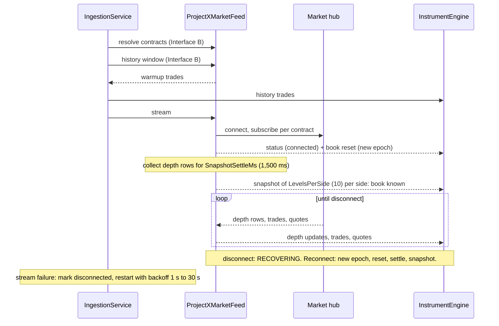

# Interfaces

Every interface the system consumes or exposes, and the contract each side may rely on. Section IDs (`A.5`, `D.2`)
are cited from the code.

Interfaces C and D are built and tested in process. Interfaces A and B are built against the documented interface
of the `MarqSpec.Client.ProjectX` client library (3.0.0) and have **not** run against the TopstepX gateway: every
mapping in A and B is an assumption until a check against a real account replaces it with evidence
([`ARCHITECTURE.md`](ARCHITECTURE.md) D-1, D-15). The open questions are at the end.

## 0. Summary

| ID | Interface | Direction | Protocol | Auth |
|---|---|---|---|---|
| A | Market data: the ProjectX market hub, or the synthetic or replay feed in its place | consumed | SignalR (WebSocket) through the client library; in process for Synthetic; a JSON Lines file for Replay | ProjectX credentials, server-side only; none for Synthetic and Replay |
| B | ProjectX contract metadata and historical bars | consumed | REST through the client library | the same credentials |
| C | Agent context and overlay | exposed | HTTPS (JSON) | API key with `read-context` / `publish-overlay` (D-16) |
| D | Browser surface: REST, the SignalR stream, layouts, health and metrics | exposed | HTTPS + SignalR | API key with `view-dashboard` / `configure-layout` (D-16); `/health/live` open |

Every caller-facing payload is JSON with camelCase names and enums as strings. Prices on the wire are integer
**tick keys** (price ÷ the contract's tick size) unless a field says it is in price units; times are Unix
milliseconds UTC unless written as ISO-8601.

## Interface A: market data

### A.1 Base URLs

The gateway and market-hub URLs are the client library's settings `ProjectX:BaseUrl` (default
`https://api.topstepx.com`) and `ProjectX:WebSocket:MarketHubUrl` (default the TopstepX market hub); this
repository sets neither. `Feed:Provider` chooses the source: `ProjectX` (the `appsettings.json` default),
`Synthetic` (the Development and compose default) or `Replay` ([`DEPLOYMENT.md`](DEPLOYMENT.md) §3). One process
holds one feed for every configured instrument (D-11, D-26).

### A.2 Calls and events

| Call or event | Purpose | Requirement |
|---|---|---|
| `ConnectMarketHubAsync`, then per contract quote and trade subscriptions, and an order-book subscription only when `DepthDemand` wants that product | Quotes and trades for every bound contract; depth only for pinned and watched products. The user hub is never opened | FR-10, FR-11, FR-54 |
| `OrderBookUpdate`: contract, `Type`, `Price`, `Volume`, `Timestamp` | Depth rows, mapped as in A.5 | FR-11, FR-12, FR-36–FR-40 |
| `TradeUpdate`: `Type` (Buy / Sell / none), `Price`, `Volume`, `Timestamp` | Executions for bars, VWAP, profile, delta and order flow | FR-13, FR-14, FR-18, FR-23, FR-39, FR-41 |
| `ConnectionStatusChanged` | Connected or disconnected; each reconnect starts a new epoch | FR-4, FR-11 |
| `PriceUpdate`: last, best bid, best ask, timestamp | Top of book for every contract, as a `quote` event; never a trade or a depth row | FR-54 |

### A.3 Flow



### A.4 Permissions requested

Market data and contract and history reads only. No order, position or account method of the client is called
anywhere, and no route or hub method can reach one (FR-6, T-1). Credentials come from configuration: set exactly
one pair, `PROJECTX_USERNAME` + `PROJECTX_API_KEY` (preferred, and it wins when both are set), or the older
`PROJECTX_API_KEY` (user name) + `PROJECTX_API_SECRET` (key). The host copies the preferred pair into the shape the
client library expects before it is built, and never logs either value. Startup fails, naming the variables, when
`Feed:Provider` is `ProjectX` and neither pair is set. One upstream session in total (D-11). A
`StoppedForSessionConflict` close stops ingestion without reconnecting (D-29), and so does a refused login (HTTP
400, 401 or 403, or a refusing `errorCode`; D-37).

### A.5 Data and error semantics

**Normalized events.** Every source (live, replay or synthetic) produces the same `MarketEvent`s. Each carries
`root`, `contractId`, `sourceTimeMs`, `receivedTimeMs`, `epoch` and a per-contract `sequence` (NFR-5), and one of
six kinds, discriminated by `kind`:

| `kind` | Fields | Meaning |
|---|---|---|
| `snapshot` | `bids`, `asks` (each `[{priceTicks, quantity}]`), `levelsPerSide` | Replaces the book; the book is known over the snapshot's range |
| `depth` | `side` (`Bid` / `Ask`), `priceTicks`, `quantity` | Absolute resting size at a price; 0 removes the level |
| `reset` | `reason` | The book is unknown until the next snapshot |
| `trade` | `priceTicks`, `quantity`, `aggressor` (`Bid` = buyer lifted the offer, `Ask` = seller hit the bid), `tradeId` | One execution; duplicates by `tradeId` are dropped and counted |
| `quote` | `bidTicks`, `askTicks` (either may be null) | Top of book for a product without depth; never makes the book known or moves a heat cell. A crossed or locked quote is ignored |
| `status` | `connected`, `provenance` (`Live` / `Replay` / `Simulated`), `depthSubscribed` (default true) | Feed health and provenance (D-14). `depthSubscribed: false` means depth is off on purpose: the book is unknown, but the status is not RECOVERING |

**Acceptance.** The engine refuses, and counts in `rejectedEvents`, an event for another root or contract, a price
off the tick grid, and an event whose `sourceTimeMs` is more than 60 s after its `receivedTimeMs`. The last are also
counted in `clockAheadRejectedEvents`, with a warning at most once a minute per root, so a slow host clock can be
told apart from bad data (FR-5).

**ProjectX mapping (unverified, D-15).**

- Prices become tick keys with the bound contract's tick size.
- Depth types `Bid`, `BestBid`, `NewBestBid` become bid `depth` events and `Ask`, `BestAsk`, `NewBestAsk` ask
  events, with `Volume` read as the absolute size. `Reset` becomes `reset` followed by a fresh settle window. Other
  types are ignored.
- A trade typed Buy is a buy aggressor and Sell a sell aggressor; untyped, the tick rule decides. Trade IDs are
  synthesized per epoch, and epochs are unique for the life of the process.
- After every (re)subscribe the feed emits a status and a reset, collects depth rows for `SnapshotSettleMs`, and
  emits one snapshot of the best `LevelsPerSide` per side. A price outside the snapshot is unknown, never zero.
- Contracts (D-26): with `Engine:Instruments` `*`, the gateway's available contracts, one per root. The root is the
  month-code name (`^ROOT[FGHJKMNQUVXZ][0-9]{1,2}$`, so ES never matches MES) or the symbol id `F.US.{root}`. A
  configured id wins, then the active contract. The gateway's tick size and value win over the catalog.
- Subscriptions: trades for every contract, quotes when `Feed:ProjectX:Quotes` is on, and depth only for the
  products `DepthDemand` wants, re-matched every 250 ms.
- History requests are spaced at least `Feed:ProjectX:HistoryMinIntervalMs` (650 ms) apart.
- Callbacks enter a bounded buffer (D-32, T-6). Each contract has its own trade queue; a trade that does not fit is
  counted and the contract is DEGRADED from that trade's exchange time. Closed one-minute bars later fill the gap
  approximately (D-33); the contract stays DEGRADED until a fresh post-subscribe book or the next session. Quotes
  and depth keep only the latest value per price, up to `DepthLevelsPerContract`; past that, the rows are discarded
  and the settle window starts again.

**Replay file format.** One JSON object per line, as in the table above; blank lines are skipped; the file is
loaded whole and sorted by `sourceTimeMs`. Times are rebased so the first event plays now, gaps are divided by
`Feed:Replay:Speed`, every event is relabelled `Replay` and its `contractId` rewritten to the configured contract.
With `Feed:Replay:Loop`, each pass starts with a reset in a new epoch. A file must contain synthetic or licensed
data only (NFR-7).

**Synthetic feed.** The same events, in process, from a seeded simulator (D-12, D-25), labelled `Simulated`, for
every catalog product.

**Timeouts and heartbeats.** The client library's defaults apply: REST retries (3, backoff 1–30 s), hub
auto-reconnect (1–5 s), a 15 s keep-alive and a 30 s server timeout. Each reported reconnect starts a new epoch.

## Interface B: contract metadata and historical bars

| Call | Purpose | Requirement |
|---|---|---|
| `GetContractByIdAsync(id)` when `Feed:ProjectX:ContractIds:{root}` is set, otherwise a contract search by root | Bind each root to one contract | FR-5, FR-10 |
| `GetHistoricalBarsAsync(contract, from, to, Minute, 1, limit 20000, includePartialBar false)` | Warmup for indicators, bars and the session profile; the same call repairs a dropped-trade gap (D-33) | FR-17, FR-25 |

- **History window.** From the earlier of now − `Feed:MinHistoryHours` and the session open, never more than 24 h
  back (and at least the 7 h the regime needs, FR-56).
- **Bars to prints.** Each one-minute bar becomes up to eight prints at four points 15 s apart, ordered by the bar's
  direction, with its volume split as evenly as whole contracts allow, so the rebuilt bar keeps its OHLC. Warmup
  therefore fills bars, indicators and the session profile approximately, never depth; CVD and the delta detectors
  count from live collection. The profile marks the warmup part as partial (FR-25).
- **Errors.** A root with no contract, a tick-size mismatch or an unreachable gateway at start is logged and
  retried with backoff (1 s doubling to 30 s), with readiness Unhealthy meanwhile. A refused login or an unknown
  configured contract id is not retried (D-37). A history failure is logged and that instrument starts with no
  warmup.

## Interface C: agent context and overlay (exposed)

| Method | Path | Grant | Purpose | Responses | Requirement |
|---|---|---|---|---|---|
| GET | `/api/context/{instrument}` | `read-context` | Read-only analytics snapshot | 200 `AgentContext`; 403; 404 | UC-5, FR-8 |
| GET | `/api/overlays/{instrument}` | `view-dashboard` | The current overlay | 200 `OverlayRequest`; 204 none; 403; 404 | FR-8 |
| POST | `/api/overlays/{instrument}` | `publish-overlay` | Publish an overlay version | 200 `{root, version, publisher, availableAt}`; 422 `{reason, message}`; 403; 404 | FR-8 |

**`AgentContext`.** The instrument (root, name, exchange, contract, expiry, tick size and value, price decimals),
`asOfMs`, `status`, last price, session high and low, `vwap`, the latest one-minute `indicators`, `profiles`,
`liquidity`, the last 30 minute bars, the last 25 signals, `icebergs`, `keyLevels` and `cvd`. It contains no
account data.

**`OverlayRequest` (schema version 1).**

| Field | Type | Rule (failure `reason`) |
|---|---|---|
| `schemaVersion` | int | Must be 1 (`UnsupportedSchema`) |
| `contractId` | string | Must equal the bound contract (`WrongContract`) |
| `version` | long | Newer than the current one; the same version again is accepted unchanged; an older one is `StaleVersion` |
| `generatedAt`, `asOf` | ISO-8601 | Neither more than 5 s in the future (`NotYetValid`) |
| `expiresAt` | ISO-8601 | After now (`Expired`) |
| `sourceCoverage` | number | 0–1, default 1 (`InvalidLevel`) |
| `levels` | `[{price, label, kind}]` | At most 50 (`TooLarge`); each price on the tick grid, label 1–80 characters, `kind` at most 80, default `reference` (`InvalidLevel`) |
| `rationale` | string | Plain text, at most 2,000 characters (`TooLarge`); rendered as text, never markup (T-3) |
| `qualityFlags` | string[] | At most 10, each at most 80 characters (`TooLarge`) |

The checks run in the order `UnsupportedSchema`, `WrongContract`, `Expired`, `NotYetValid`, `InvalidLevel` (for a
JSON `null` list), `TooLarge`, `InvalidLevel`, `StaleVersion`, and the first failure is returned. An accepted
overlay becomes visible at the server's receive time and reaches viewers in the next delta. The publisher recorded
is the key's `Name`. The reference agent (D-17) uses exactly this interface.

## Interface D: the browser surface (exposed)

### D.1 HTTP endpoints

The OpenAPI document is generated at runtime: in Development the API serves it at `/openapi/v1.json`.

| Method | Path | Grant | Purpose | Responses | Requirement |
|---|---|---|---|---|---|
| GET | `/api/instruments` | any key | The instruments the caller may view, in picker order, each with its info, `status`, `summary` and tab quote (last, open, change, VWAP, nearest level and its touches) | 200 | FR-10, FR-55, FR-57 |
| GET | `/api/snapshot/{instrument}?historyMinutes=&indicatorMinutes=` | `view-dashboard` | A full `DashboardSnapshot`; `indicatorMinutes` (1, 5 or 15) keeps one timeframe | 200; 403; 404 | FR-1, FR-4 |
| GET | `/api/layouts/me` | `view-dashboard` | `{saved, revision, layout}`; `saved` false and `revision` 0 when nothing is stored, with the defaults | 200; 403 | FR-9 |
| PUT | `/api/layouts/me` | `configure-layout` for the layout's instrument | Save `{revision, layout}`; stored only when `revision` matches the stored counter | 200; 409 with the stored document; 400 `ValidationProblem`; 403 | FR-9 |
| GET | `/health/live` | none | The process is up | 200 | NFR-3 |
| GET | `/health/ready` | a caller outside Development (D-30) | Ingestion state per instrument ([`OBSERVABILITY.md`](OBSERVABILITY.md) §3) | 200 Healthy / Degraded; 503 Unhealthy; 401 | NFR-3, FR-4 |
| GET | `/metrics` | as `/health/ready` | Prometheus exposition ([`OBSERVABILITY.md`](OBSERVABILITY.md) §2) | 200; 401 | — |

**Authentication (D-16, D-30).** `X-Api-Key: <key>` on every request. On `/hubs` paths only, SignalR may pass the
key as `access_token` in the query string or as `Authorization: Bearer`. No key gets the configured anonymous
grants (all four in Development, none in production, so 401). An unknown key is always 401. A grant is
`permission:scope`, with scope an instrument root or `*`.

**`LayoutSettings`.** `instrument` (a root, default `MES`); `watchlist` (up to `Api:MaxWatchlist` distinct roots,
default `MES`, `MCL`, `MGC`); `sliceSeconds` (1 or 5); `chartMinutes` (1, 2, 5 or 15, default 1);
`indicatorMinutes` (1, 5 or 15, default 1); `heatMode` (`intensity` or `flow`); `historyMinutes` (5–4,320, default
240); `heatContrast` (0.1–5.0); `eventDotSize` (`small`, `medium`, `large`); `centerPrice` (boolean);
`indicatorPane` (`footprint`, `cvd`, `rsi14`, `macd`, `atr14` or `tpo`, default `footprint`);
`indicatorDockCollapsed` (boolean, default false); `sideSectionsCollapsed` (any of `ladder`, `liquidity`, `signals`,
`levels`, `profile`, `layers`; default none); `showPriceLine` (boolean, default true); `panes` and `signals` (the
pane and signal ids the client knows). For the optional fields, a PUT that omits one keeps the stored value, and an
explicit null or an unknown value is refused with 400 (FR-9). Layouts are held in memory per key name; after a
restart the dashboard re-sends its local copy when it matches the schema.

**`summary`** (FR-55, FR-57; built from trades and quotes only, so cheap for every product): `last`, `bid`, `ask`,
session open, high and low, `sessionVolume`, `cumulativeDelta`, `delta60s`, `tradeRate`, `lastTradeMs`,
`latestSignal`, `signals15m` and `regimes` (one per regime timeframe: trend, readiness and every input, FR-56).

### D.2 Streaming

**Hub:** `/hubs/market`, authenticated as in D.1; maximum client message 64 KB.

| Client method | Does |
|---|---|
| `Subscribe(instrument, historyMinutes)` | Returns a `DashboardSnapshot`; needs `view-dashboard` for that instrument |
| `SetIndicatorTimeframe(instrument, indicatorMinutes)` | 1, 5 or 15; remembered for that connection and instrument |
| `Unsubscribe(instrument)` | Stops that instrument's deltas |
| `SetWatchlist(instruments[])` | Returns `{depth, refused}`: the products this connection wants depth for besides the open one, up to `Api:MaxWatchlist` |

The server calls `delta` with one `DashboardDelta`. There is no other hub method, and none can trade (FR-6). A
connection holds depth for what it subscribed to and its watchlist until it unsubscribes, replaces the list or
disconnects (FR-54).

```mermaid
sequenceDiagram
  participant B as Browser
  participant H as MarketHub
  participant P as MarketPublisher
  B->>H: SetIndicatorTimeframe("MES", 1)
  B->>H: Subscribe("MES", 240)
  H->>H: join the instrument's group, then take the snapshot
  H-->>B: DashboardSnapshot (seq = N)
  loop every Api:PublishMs (250 ms)
    P-->>B: delta (seq N+1, N+2, …)
  end
  Note over B: drop deltas with seq ≤ N; a gap in seq: take a new snapshot
```

**Ordering.** The connection joins the group before the snapshot is taken, so no later delta is missed; the client
drops any delta whose `seq` is at or below the snapshot's. `seq` rises by one per publication per instrument, and a
gap makes the client resubscribe. There is no resume token. A browser still taking the previous delta is skipped,
and one whose send exceeds `Api:PublishTimeoutMs` is disconnected (D-32).

**`DashboardSnapshot`** carries `root`, `seq`, `serverTimeMs`, `instrument`, `status`, `heat`, `bars`,
`developingBar`, `minuteBars`, `developingMinute`, `minuteHeat`, `developingMinuteHeat`, `levelTouches`,
`indicators`, `profiles`, `vwap`, `liquidity`, `ladder`, `overlay`, `sessionHigh`, `sessionLow`,
`historyWatermarkMs`, `prints` and `orderFlow`. **`DashboardDelta`** carries the same fields except `instrument` and
`historyWatermarkMs`. In a delta, the series (`heat`, `bars`, `minuteBars`, `minuteHeat`, `prints`, indicator
points, footprints, CVD points and signals) carry only what is new, and the client appends them; a gap repair may
repeat an older minute bar or footprint, which replaces that bin (D-33). Every other field is the full current
value.

| Field | Shape |
|---|---|
| `status` | `code` (LIVE / REPLAY / SIMULATED / DEGRADED / STALE / RECOVERING), `provenance`, `connected`, `bookKnown`, `depthSubscribed`, `epoch`, `lastEventAgeMs`, covered range, `sessionId`, `exchangeOpen`, `recentCoverage`, counters (`duplicateTrades`, `rejectedEvents`, `clockAheadRejectedEvents`, `bookResets`, …), `missingSinceMs`, `cvdKnown`, `approximate` |
| `heat[]` | `{t, d, c}`: slice start, duration and time-weighted size per tick over the covered range (FR-12) |
| `bars[]`, `minuteBars[]` | `{t, d, o, h, l, c, v, bv, sv, n}`; null prices for an empty bin |
| `indicators[]` | `{id, label, kind, tf, warmup, seen, ready, points, dev}`; a hub message carries only the connection's timeframe |
| `profiles[]` | `{window, bins, total, poc, vah, val, vaFraction, partialSinceMs, missingRanges, approximateRanges, hvn, lvn}` for `session`, `1h`, `4h`, `5d` |
| `levelTouches[]` | `{name, priceTicks, isHigh, touches, lastTouchMs, isThirdTouch, sessionId, asOfMs}` |
| `prints[]` | `{sourceTimeMs, priceTicks, quantity, aggressor, sequence}`; live executions only, capped at `Engine:PrintCapacity` (D-34, FR-61) |
| `vwap` | `{vwap, stdDev, volume, partial, anchor}` |
| `liquidity` | FR-36–FR-40, with `quoteTimeMs` and `quoteStale` |
| `ladder` | `{bids, asks}`, `Engine:LadderLevels` per side |
| `overlay` | the current overlay with its times, `expired` flag, levels and rationale, or null |
| `orderFlow` | `cvd`, `cvdPoints`, `footprints[]` and `developingFootprint` (cells per tick with bid volume, ask volume and imbalance flag), `signals[]`, `lastSignalId`, `icebergs`, `zones`, `unfinishedAuctions`, `keyLevels`, `tpo`, `footprintSeconds` |

The TypeScript client validates every message against its schemas (`src/dashboard/src/api/schemas.ts`) and refuses
one that does not match.

## Non-functional contract

- **Upstream (A, B).** Each (re)connect is a new epoch with a reset; the book is unknown until the settle-window
  snapshot. A stream failure marks every instrument disconnected and restarts with backoff from 1 s to 30 s,
  unless the login was refused (D-37).
- **Browser (D).** Deltas every `Api:PublishMs` (250 ms, clamped 50–5,000); one send in flight per connection; a
  send still running after `Api:PublishTimeoutMs` (1,000 ms) aborts the connection (D-32). The payload has no
  per-message schema version: a breaking change to D.2 ships the dashboard and the API together.
- **Agent (C).** Overlays are idempotent by (instrument, version); the newest valid version wins; expired overlays
  are flagged until replaced.
- **Versioning.** The overlay body is versioned (`schemaVersion` 1); the hub and REST shapes are versioned with the
  release ([`CONVENTIONS.md`](CONVENTIONS.md) §14).

## Open questions about the live feed

| # | Question | Interface |
|---|---|---|
| 1 | Depth entitlement on the account for the CME, COMEX and NYMEX products | A |
| 2 | Whether depth `Volume` is absolute or incremental, and which depth types are actually sent | A |
| 3 | Whether a baseline arrives on subscribe and after reconnect, and whether 1,500 ms is enough to settle it | A |
| 4 | How many depth levels per side are delivered | A |
| 5 | Trade identifiers for de-duplication across reconnects | A |
| 6 | Heartbeats during quiet markets (affects STALE) | A |
| 7 | Concurrent-session limits on one account | A |
| 9 | Gateway rate limits for contract search and history | B |
| 10 | Executed-volume-at-price backfill instead of bars expanded to prints (FR-25) | B |
| 12 | Whether a traded-through depth decrement arrives before or after its trade print; the pulled-liquidity detector assumes after | A |
| 13 | Overlay `version` across several publishers: the reference agent publishes epoch-millisecond versions, so another publisher using small integers is refused as stale | C |
