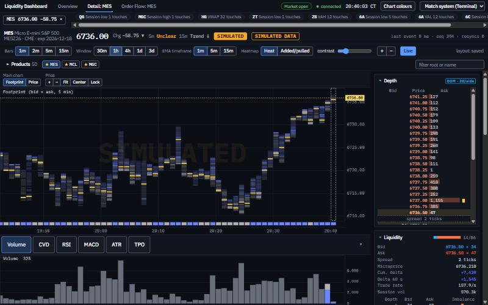
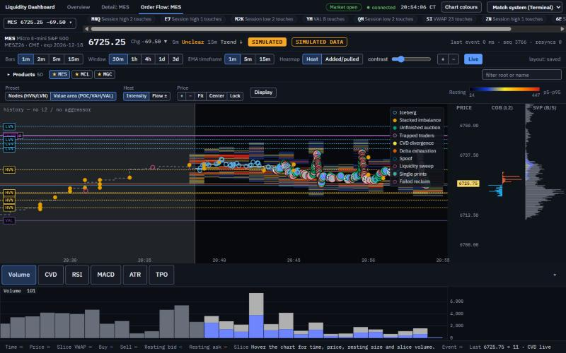
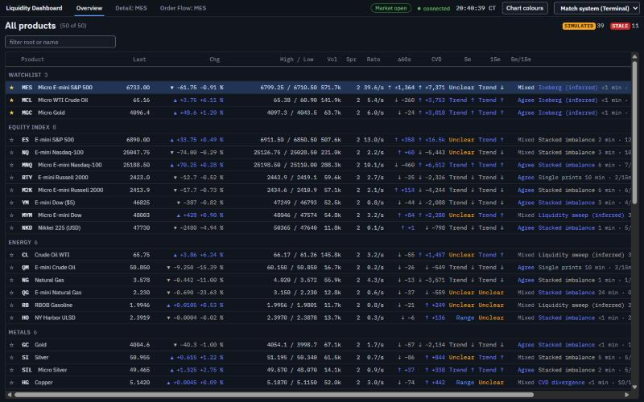
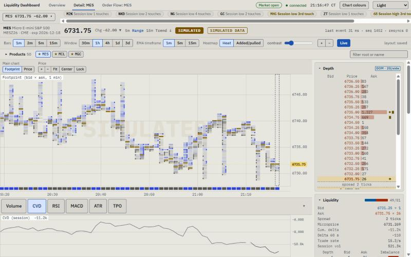

# Live Futures Liquidity Dashboard

A read-only, live view of resting liquidity beside executed price, for every futures product a market-data feed
offers. MES, MCL and MGC (the micro S&P 500, crude oil and gold contracts) are the default favorites; an Overview
lists every product, and order-book depth is kept for those three and for the products a viewer opens or stars.

One ASP.NET Core service holds a single market-data session for every instrument. For each one it builds a
liquidity heatmap, one-minute bars, indicators, volume and TPO profiles, liquidity metrics and order-flow signals
(footprint, CVD, icebergs, pulled liquidity, stop runs), and streams them to a React and TypeScript dashboard over
SignalR. **Nothing in it can place, change or cancel an order.** You can draw one *simulated position* per product (an
entry, a stop and up to three targets), watch it tracked against the live prints, and ask for advisory feedback on it.
The position stays on the dashboard and is never sent to a broker. Feedback is hidden unless the server enables it
and has a Claude API key; it is always labelled advisory, and a deterministic `Mock` provider (no key, no cost) is the
Development default ([`REQUIREMENTS.md`](REQUIREMENTS.md) FR-72–FR-74).

Out of the box it runs on a **seeded synthetic market** that needs no credentials, and it can replay a recorded
file. Every instrument always says where its data came from: `LIVE`, `REPLAY` or `SIMULATED`.

> [!WARNING]
> **The TopstepX (ProjectX) adapter is unverified.** It was written against the client library's documented
> interface and has never run against the live gateway. Treat live depth for any instrument as untrusted until it
> has been checked against a real account ([`ARCHITECTURE.md`](ARCHITECTURE.md) D-1, D-15). Do not run it in a
> shared environment before then.

## Why this project exists

This started as a working system for one trader: a dashboard that consumes a real-time market-data feed and shows resting liquidity beside executed price. It was built AI-first. AI coding agents wrote the code, the tests and the documentation, working from a written set of requirements, decisions and role contracts, with every change reviewed before it merged.

It is shared as a starting place. If you want a dashboard of your own (different products, panels, signals or data feed), the engineering that every such system needs is already done, and you can spend your time on what makes yours different. It is a read-only view with no order entry, and it makes no claim of trading edge or fitness for trading. The engineering it gives you:

- one upstream market-data session shared by every viewer ([`ARCHITECTURE.md`](ARCHITECTURE.md) D-7, D-11);
- streaming to the browser over SignalR ([`INTERFACES.md`](INTERFACES.md));
- provenance on every instrument (`LIVE`, `REPLAY` or `SIMULATED`) and staleness shown, so simulated or replayed data is never presented as live ([`REQUIREMENTS.md`](REQUIREMENTS.md) FR-4);
- a seeded synthetic feed and a file replay, so you can develop without credentials ([`ARCHITECTURE.md`](ARCHITECTURE.md) D-12);
- configuration and secrets through environment variables ([`CONVENTIONS.md`](CONVENTIONS.md) §6, [`DEPLOYMENT.md`](DEPLOYMENT.md) §3);
- API-key authentication with per-instrument grants, and no route or hub method that can place, change or cancel an order ([`CONVENTIONS.md`](CONVENTIONS.md) §4, §11–§12, [`ARCHITECTURE.md`](ARCHITECTURE.md) T-1; keys: D-16);
- health, readiness and Prometheus metrics ([`OBSERVABILITY.md`](OBSERVABILITY.md));
- container images, a documented build-and-deploy path and a list of quality checks for a build server ([`DEPLOYMENT.md`](DEPLOYMENT.md) §5, §9, [`CONVENTIONS.md`](CONVENTIONS.md) §10);
- the documents that explain why each part is the way it is: requirements ([`REQUIREMENTS.md`](REQUIREMENTS.md)), design decisions ([`ARCHITECTURE.md`](ARCHITECTURE.md)) and a threat model ([`ARCHITECTURE.md`](ARCHITECTURE.md), *Threat model*).

## Screenshots

All five are taken from the synthetic feed, so every price, size and signal in them is simulated, and each view
says so: the `SIMULATED` badges in the header, the watermark on the Detail chart and the provenance counts on the
Overview.

**Detail**: the footprint as the main chart, the depth ladder and side column on the right, and the indicator dock
open on its Volume tab underneath.



**Order Flow**: the liquidity heatmap with volume dots and event markers on one price scale, the PRICE, COB and
SVP columns docked at the right, and the same indicator dock underneath. The grey band at the left is warmup
history, which carries no depth and no aggressor side.



**Overview**: every product the feed offers, with its last price, change, range, volume, flow, trend and latest
signal, and the count of products in each provenance state.



**The Light theme**, here on Detail over a one-hour window, with the dock on its CVD tab.



**Range zones.** Detail and Order Flow can shade, as neutral boxes behind the price, the stretches where a product was
ranging by the same rule as its trend regime ([`REQUIREMENTS.md`](REQUIREMENTS.md) FR-75). They default to 5-minute bars
and can be switched off in the Layers section.

**Position feedback**: a simulated long on MES with its entry, stop and target lines, and the feedback panel beside the
chart. Both labels are in view: the `SIMULATED` ticket and lines, and, because this is the Mock provider, the `MOCK`
label beside the advisory footer.


## Documents

| Document | What it covers |
|---|---|
| [`REQUIREMENTS.md`](REQUIREMENTS.md) | What the system does and for whom: use cases (`UC-n`) and requirements (`FR-n`, `NFR-n`) |
| [`ARCHITECTURE.md`](ARCHITECTURE.md) | The projects, the components, the data flow, the design decisions (`D-n`) and the threat model (`T-n`) |
| [`INTERFACES.md`](INTERFACES.md) | The market-data feed, the REST API, the SignalR stream and the overlay contract |
| [`DEPLOYMENT.md`](DEPLOYMENT.md) | Configuration, building the images, deploying, rolling back, the phone app and known quirks |
| [`OBSERVABILITY.md`](OBSERVABILITY.md) | Health checks, readiness and the Prometheus metrics |
| [`CONVENTIONS.md`](CONVENTIONS.md) | The stack and the coding, testing, security and versioning rules |
| [`PROMPTS.md`](PROMPTS.md) | The system prompt sent to Claude for position feedback, and why each rule in it exists |

Code comments cite these documents by ID (`FR-54`, `D-30`, `T-4`, `CONVENTIONS.md §8.1`); each ID is defined once,
in the document named.

## Repository layout

| Path | What is there |
|---|---|
| `src/` | The .NET solution (`.slnx`) and its projects, named for the base namespace MarqSpec.FuturesLiquidityDashboard |
| `src/*.Api/` | The ASP.NET Core host: REST, the SignalR hub, authentication, the hosted ingestion |
| `src/*.Ingestion/` | The market-data feeds: synthetic, replay and ProjectX |
| `src/*.Core/` | The per-instrument engine: book, heatmap, bars, indicators, profiles, order flow. No I/O |
| `src/dashboard/` | The React + TypeScript (Vite) dashboard, and `android/`, a Capacitor debug shell |
| `src/tests/` | The unit and integration test projects |
| `scripts/` | `deploy.sh` and `smoke-check.sh` (deploying), `check-versions.sh` (the version gate), and their tests |
| `Dockerfile`, `src/dashboard/Dockerfile`, `compose.yaml` | The two images and local development |

## Prerequisites

- The .NET SDK pinned in `global.json` (.NET 10).
- Node.js 24 and Corepack, which runs the pnpm version pinned in `package.json` (`packageManager`).
- Docker, if you want to run the images.

## Build, run and test

In short: build with `dotnet build src`, test with `dotnet test src` and `pnpm test`, and lint with `pnpm lint`.
The details follow.

**The server**, from the repository root (in bash, `src/*.Api` names the API project):

```bash
dotnet build src
dotnet run --project src/*.Api --launch-profile http   # http://localhost:5080, synthetic feed
```

**The dashboard** (a pnpm workspace):

```bash
corepack enable && pnpm install
pnpm --filter dashboard run dev     # http://localhost:5173; proxies /api, /health and /hubs to port 5080
```

**Tests and checks:**

```bash
dotnet test src                                               # unit and integration tests (the API hosted on the synthetic feed)
pnpm lint                                                     # oxlint across the frontends, warnings are errors
pnpm test                                                     # the dashboard's unit tests (vitest)
pnpm build                                                    # type-check (tsc -b) and production build
bash scripts/check-versions.sh                                # every project carries the one version
```

**With Docker**, the same images that ship:

```bash
docker compose up --build                       # the API on http://localhost:5080, the dashboard on http://localhost:5173
docker compose --profile test build unit-tests  # the unit tests, inside the image build
```

Compose runs the API in Development, so the page asks for no key and every service listens on `127.0.0.1` only.
Saved layouts and the feedback budget are kept on the named volume `api-data`, so they survive
`docker compose down` and `up`; `docker compose down -v` clears them.
`http://localhost:5080/health/ready` shows each instrument's status once the warmup has loaded. Outside
Development the page asks for a viewer key ([`ARCHITECTURE.md`](ARCHITECTURE.md) D-30) and `/health/ready` requires
it; the anonymous check is `/health/live`.

**Which products.** By default every product the feed offers runs (`Engine:Instruments` `*`; about 50 on the
synthetic feed), with depth only for the pinned products and those a viewer opens or stars (FR-54). Warming all of
them up takes about a minute and a half on the synthetic feed, longer early in a session, since the warmup window also
seeds the five-minute EMA 200 ([`ARCHITECTURE.md`](ARCHITECTURE.md) D-68). For a quicker start, name a few:
`Engine__Instruments__0=ES Engine__Instruments__1=GC Engine__Instruments__2=CL`
([`DEPLOYMENT.md`](DEPLOYMENT.md) §3).

## Choosing the market data

`Feed:Provider` picks one of three feeds ([`DEPLOYMENT.md`](DEPLOYMENT.md) §3):

| Provider | Needs | Labelled |
|---|---|---|
| `Synthetic`, the default in Development and in compose | nothing | `SIMULATED` |
| `Replay`, a JSON Lines file of normalized events (`Feed__Replay__Path`) | a file of synthetic or licensed events | `REPLAY` |
| `ProjectX`, TopstepX: **unverified** | `PROJECTX_USERNAME` and `PROJECTX_API_KEY` | `LIVE` |

To use TopstepX, keep the credentials out of the repository, in `dotnet user-secrets` or your shell:

```bash
export PROJECTX_USERNAME=<topstep-username>
export PROJECTX_API_KEY=<api-key>

# Headless market-hub check: quotes, trades and depth for MES, MCL and MGC. No user hub, no orders.
dotnet run --project src/*.Api -- live-smoke --seconds 60

# The full dashboard, once the check shows events.
Feed__Provider=ProjectX dotnet run --project src/*.Api --launch-profile http
```

Set exactly one credential pair. The older pair (`PROJECTX_API_KEY` as the user name and `PROJECTX_API_SECRET` as
the key, with `PROJECTX_USERNAME` unset) still works; when both are set, the pair above wins. A
`StoppedForSessionConflict` close stops ingestion without reconnecting, and `live-smoke` then exits 3. A login the
gateway refuses also stops only ingestion: readiness says so, and nothing logs in again until you fix it and
restart. Startup fails at once, naming the variables, when neither pair is set.

**Provenance is always on screen.** Each instrument shows exactly one status: `LIVE`, `REPLAY` or `SIMULATED`
while healthy, `DEGRADED` while trades are missing, `STALE` after 3 s with no event, or `RECOVERING` while
disconnected or before the book is known. A simulated or replayed market can never show `LIVE` (D-14).

## Position feedback

Feedback on a simulated position is off in production (`Feedback__Enabled=false`) and on, with the `Mock` provider, in
Development and compose. To use Claude, set `Feedback__Enabled=true` and the key as a secret in your shell or on the
host, never in a file:

```bash
export ANTHROPIC_API_KEY=<api-key>
Feedback__Enabled=true Feedback__Provider=Claude dotnet run --project src/*.Api --launch-profile http
```

Only the position's derived metrics are sent, one request at a time per viewer and six a minute, under a monthly
spend cap (`Feedback__MonthlyBudgetUsd`, $100, kept in `Feedback__BudgetStorePath` so a restart in the same month
resumes the count). A viewer needs the `request-feedback` grant as well
as `view-dashboard` ([`DEPLOYMENT.md`](DEPLOYMENT.md) §3). The feedback is advisory, not financial advice, and nothing
it says is ever sent to a broker.

## Licence

MIT; see [`LICENSE`](LICENSE). Market data is not covered by it: whoever connects a live feed is responsible for
the rights to store and display that data (NFR-7). Test fixtures and the synthetic feed contain no real market or
account data.
